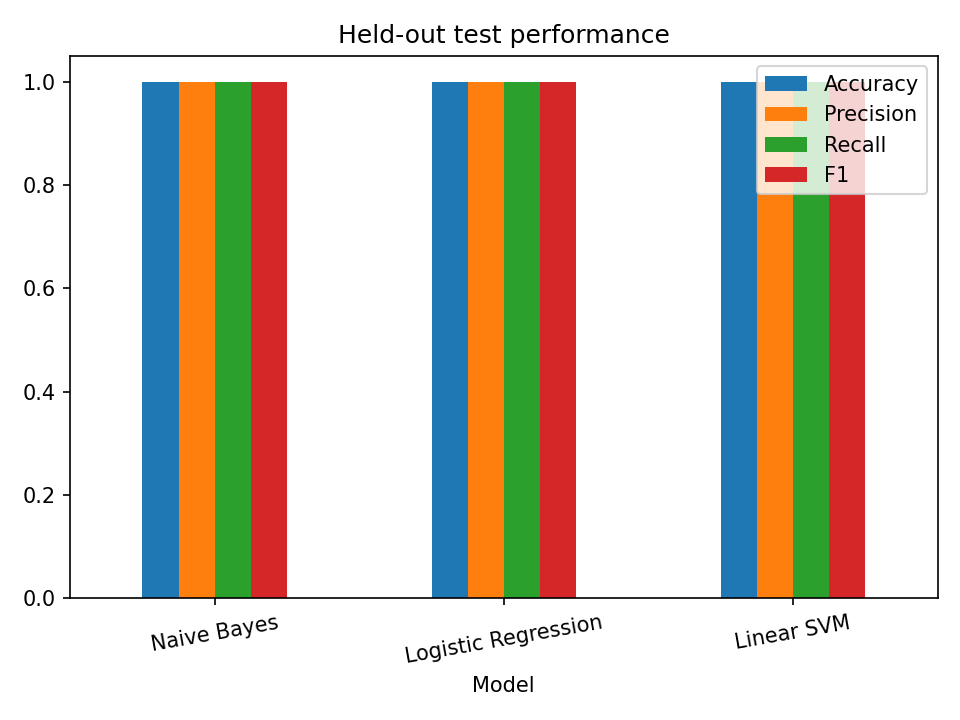
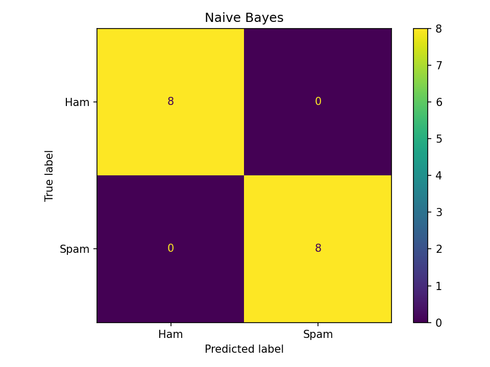

# Email Spam Detection using Machine Learning

MNR University — School of Engineering, Technology and AI | ML Mini Project

## Team members
| Name | Roll number |
|---|---|
| Srivalli | Add actual roll number |

Add any other actual team members before submission.

## Project description
Classifies email text as Spam (1) or Ham (0) using supervised machine learning. The program cleans email text, extracts TF-IDF features, trains three classifiers, evaluates a held-out test set, and saves the model selected by training-only cross-validation F1.

## Dataset
- Intended dataset: [Apache SpamAssassin public corpus](https://spamassassin.apache.org/old/publiccorpus/). The script downloads `20030228_easy_ham.tar.bz2` and `20030228_spam.tar.bz2` automatically when no CSV is provided.
- Alternative: Supply a labelled email CSV with columns `text,label` (labels `ham,spam` or `0,1`). Do not publish private messages.
- `data/synthetic_smoke_test.csv` contains 80 authored example messages, only for verifying execution. It includes closely related message variants. It is not a copy of the public corpus and cannot establish real-world accuracy.

## Algorithms
- Multinomial Naive Bayes
- Logistic Regression
- Linear Support Vector Machine (Linear SVM)

## Install and run
Open CMD inside the project directory on Windows. Use `python3` instead of `python` on macOS if needed.

```sh
python -m pip install -r requirements.txt
python Email_Spam_Detection.py
```

The default run requires internet access. To use a downloaded labelled CSV instead:

```sh
python Email_Spam_Detection.py path/to/emails.csv --message "Please attend the meeting tomorrow"
```

To reproduce the offline smoke test:

```sh
python Email_Spam_Detection.py data/synthetic_smoke_test.csv --output smoke_test_results
```

## Results
The offline test completed with 80 synthetic messages (40 per class), 64 training and 16 test samples. All three models classified all 16 test examples correctly. These tiny, repetitive synthetic examples are deliberately easy and do **not** demonstrate real email accuracy. Model selection in this run: Naive Bayes (training CV F1 tied with Logistic Regression at 0.9846). The real public-corpus evaluation remains pending; network access was unavailable when preparing this package. Run the default command on your computer and add its actual metrics and graphs to the repository and report before final submission.

| Model | Synthetic CV F1 | Synthetic test accuracy |
|---|---:|---:|
| Naive Bayes | 0.9846 | 100% |
| Logistic Regression | 0.9846 | 100% |
| Linear SVM | 0.9692 | 100% |





## Repository files
- `Email_Spam_Detection.py` – source code
- `requirements.txt` – dependencies
- `data/` – labelled synthetic smoke-test CSV
- `smoke_test_results/` – actual smoke-test execution log, graphs and metrics
- `spam_results/` – generated after running the public corpus (not included yet)
- `Project_Report.docx` – draft report
- `Project_Presentation.pptx` – draft presentation
- `Email_Spam_Detection_Demo.mp4` – narrated walkthrough of the code and synthetic execution

## Demo video
[View the demo video](Email_Spam_Detection_Demo.mp4). It demonstrates the offline test; it is not a live recording or public-corpus benchmark.

## Limitations
A real evaluation needs diverse email messages and independent test examples. Content changes and adversarial spam can reduce accuracy. Never rely on the classifier alone to delete emails.
